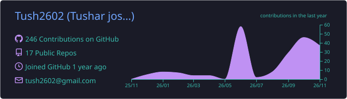
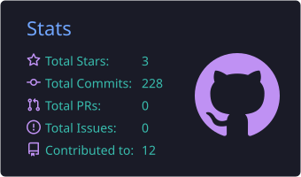
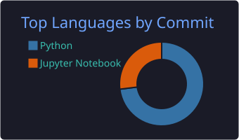

<!-- Header banner -->
<p align="center">
  
</p>

<p align="center">
  <a href="https://git.io/typing-svg">
    
  </a>
</p>

<p align="center">
  <a href="https://www.linkedin.com/in/tushar-joshi-47a5a9311"></a>
  <a href="https://github.com/Tush2602"></a>
  <a href="https://www.kaggle.com/tush2602"></a>
  <a href="mailto:tush2602@gmail.com"></a>
</p>

---

### 👋 About Me

```python
class TusharJoshi:
    education  = "B.Tech Electrical Engineering + Minor in AI @ PEC Chandigarh (2024–2028)"
    focus      = ["Recommender Systems", "Deep Learning", "MLOps", "Agentic AI"]
    building   = "VolWatch"
    practicing = "DSA on NeetCode"
    open_to    = ["ML / Data Science Internships", "Open-source collabs"]
```

- 🔭 I like taking models **beyond the notebook**: REST APIs, Docker, drift monitoring, auto-retraining.
- 🎯 Built a Two-Tower recommender that beats SVD by **79.9% on NDCG@10** and lifts long-tail coverage **28×**.
- 🧠 Implemented the Transformer (*Attention Is All You Need*) **from scratch** for English → Hindi.

---

### 🎓 Education

| Institution | Program | Duration | Score |
|---|---|---|---|
| **Punjab Engineering College (Deemed to be University)**, Chandigarh | B.Tech, Electrical Engineering · Minor in Artificial Intelligence | 2024 – 2028 (expected) | CGPA 7.99 (Major) · 8.50 (Minor) |
| **Maharishi Vidya Mandir**, Haldwani | Class XII (CBSE) | 2021 – 2023 | 93.0% |
| **K.V. Convent Higher Secondary School**, Haldwani | Class X (CBSE) | 2008 – 2021 | 93.6% |

---

### 🏆 Achievements & Certifications

- 🥇 **Amazon ML Challenge 2026**: ranked **1,800 of 32,000+ teams (Top 6%)** with an F0.5 score of **0.969**
- 🎖️ **Reliance Foundation Undergraduate Scholar** (2024–2025), awarded for academic excellence
- 🥈 **NPTEL: Introduction to Machine Learning**, Silver Elite (**Top 5% nationwide**)
- 📜 **Advanced SQL Certificate**, HackerRank

---

### 🚀 Featured Projects

| Project | Highlights | Stack |
|---|---|---|
| 🎬 **[CineMate-V2](https://github.com/Tush2602/CineMate-V2)**<br>Hybrid movie recommender | Two-Tower NCF + DistilBERT embeddings trained on **25M ratings**. **NDCG@10 0.1203 (+79.9% vs SVD)**. Popularity-aware BPR loss lifts long-tail coverage **28× (0.63% → 17.9%)**. 9-endpoint API on HF Spaces | PyTorch · DistilBERT · FastAPI · Docker |
| ⚙️ **[Production ML Pipeline](https://github.com/Tush2602/Production-ML-Pipeline-with-Drift-Monitoring-Auto-Retraining-Scalable-Deployment)**<br>Churn prediction + MLOps | **0.84 ROC-AUC, 90.1% recall** on imbalanced data. KS-test drift detection triggers **auto-retraining**. Stateless inference service deployed on Render | Scikit-learn · FastAPI · Docker |
| 📝 **[Blog Generation Agentic AI](https://github.com/Tush2602/Blog-Generation-Agentic-AI-System-)**<br>Stateful LLM workflow | LangGraph nodes for SEO titles and content, with **conditional routing** for Hindi/French translation. Traced with LangSmith and served through FastAPI | LangGraph · Groq · LangSmith · FastAPI |
| 🔤 **[AkharFormer](https://github.com/Tush2602/AkharFormer)**<br>Transformer from scratch | English → Hindi translation with custom multi-head attention, positional encoding and a full training pipeline | PyTorch |
| 💬 **[AgenticChatbot](https://github.com/Tush2602/AgenticChatbot)**<br>Conversational agent | Tool-using LLM chatbot | LangChain · Python |
| 📈 **[VolWatch](https://github.com/Tush2602/VolWatch)** | 🚧 In progress | Python |

---

### 🛠️ Tech Stack

**Languages**
<p>
  
  
</p>

**ML / Deep Learning**
<p>
  
  
  
  
  
</p>

**LLMs & Agentic AI**
<p>
  
  
  
  
</p>

**MLOps & Deployment**
<p>
  
  
  
  
  
</p>

**Data & Analysis**
<p>
  
  
  
  
  
</p>

---

### 📊 GitHub Stats

<p align="center">
  
</p>

<p align="center">
  
  
</p>

<p align="center">
  
</p>

---

### 🐍 Contribution Snake

<p align="center">
  <picture>
    <source media="(prefers-color-scheme: dark)" srcset="https://raw.githubusercontent.com/Tush2602/Tush2602/output/github-snake-dark.svg" />
    <source media="(prefers-color-scheme: light)" srcset="https://raw.githubusercontent.com/Tush2602/Tush2602/output/github-snake.svg" />
    
  </picture>
</p>

---

<p align="center">
  
</p>
